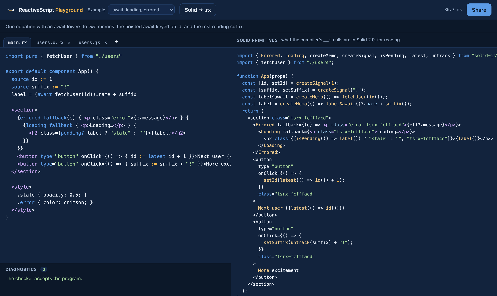

# ReactiveScript Playground



Type `.rx` on the left and see it as Solid 2.0 on the right: the program written with Solid's own primitives
(`createSignal`, `createMemo`, `createOptimistic`, `action`, `<Errored>`, `<Loading>`) and the checker's diagnostics
(each linked to `guide/diagnostics.md#<code>`). The program is kept in the URL hash, so a link reopens it, the Solid → .rx side included.

The Solid view is the JSX the crate hands to Solid's compiler, with each `__rt` helper that is a Solid primitive
underneath written as that primitive and the mangled names (`v$id`, `w$id`) made plain (`src/solidify.ts`), then
formatted with Prettier. It is a reading aid, not the code that runs.

## How it compiles in the browser

`public/rxc.wasm` is the crate (`compiler/` in this repository) built for `wasm32-unknown-unknown`, the same build the
language server loads (`compiler/src/wasm.rs`: `rx_alloc`, `rx_call`, `rx_free`, and a host `env.rx_read`). The page
answers `rx_read` from the editor's files in memory, so there is no server and no filesystem. Each keystroke sends
`analyze` (diagnostics) for every `.rx` file and `app` with `jsx: true` for `main.rx`.

The `app` request is new: `app::app_with` takes a reader in place of the disk, `serve.rs` routes `app` to it, and with
`jsx: true` each module also carries the JSX printed before Solid's compiler runs (`emit::view_jsx`, over
`oxc_codegen`). `pnpm wasm` rebuilds `../../compiler` and copies the result into `public/` (it is not checked in).

The playground is not part of the deployed site: `site/.assetsignore` leaves `playground/` out of the static upload.
Publishing it would need a build step (`pnpm wasm && pnpm build`) and its `dist/` served under `/playground/`.

## Solid → .rx (prototype)

The header's **Solid → .rx** button turns the page around: Solid 2.0 on the left, the same program as `.rx` on the
right (`src/torx.ts`). It parses the Solid with the Babel parser Prettier already carries, reads the forms the Solid
view produces (signals, memos, stores, keyed and draft projections, actions with guesses, `Show`, `For`, `Errored`,
`Loading`, prop patterns), and lists everything else under "Not converted" with its line instead of guessing.
Plain TypeScript beside a component (data, `async` functions, anything with statements) moves to `helpers.ts`, which
the `.rx` imports; a call to one of its `async` functions from reactive scope is written as an `await`. The
compiler then checks the `.rx`, so a Solid program with, say, an await and no `Errored` boundary gets
`UNHANDLED_FAILURE`.

The same button turns the page back. Each way round, the left side gets what the right side showed: the Solid view
going in, and the `.rx` (with its `helpers.ts`) coming back, unless the reading left something out, in which case
the editor keeps the program it had.

`pnpm test:torx` is the round trip: each example's `.rx` → Solid view → `.rx` → Solid view must give the same view,
plus hand-written Solid that must convert and compile, or be refused with reasons.

## Types on hover, and completion

Both editors answer two questions from TypeScript's language service, which runs in a Web Worker
(`src/types.worker.ts`) that loads on the first hover or completion (7.9 MB, 1.7 MB gzipped, with TypeScript, its
DOM and ES libraries, and Solid's types).

For `.rx`, the worker reads what the editor extension reads: the crate's TSX projection of each module and its
mappings onto the `.rx` (`analyze`, spec/13 TY-1c). `src/hover.ts` takes the offset under the pointer or at the caret
through those mappings, so `id` reads `source id: number`, an attribute shows its documentation, and `user.` offers
the store's fields. A `.d.rx`'s functions are declared from their written parameters. Names every JavaScript module
has are left out, because `.rx` has none.

In the Solid → .rx pane the worker reads the Solid source as it is. Every `solid-js` export is offered where a name
can stand, and picking one that is not imported adds it to the import.

## Run

```sh
. ~/.local/share/solid-toolchain/env.sh
corepack pnpm@11.9.0 install
corepack pnpm@11.9.0 wasm     # needs Rust with the wasm32-unknown-unknown target
corepack pnpm@11.9.0 dev      # vite --host on port 3020
corepack pnpm@11.9.0 test     # Playwright against the running dev server
```
